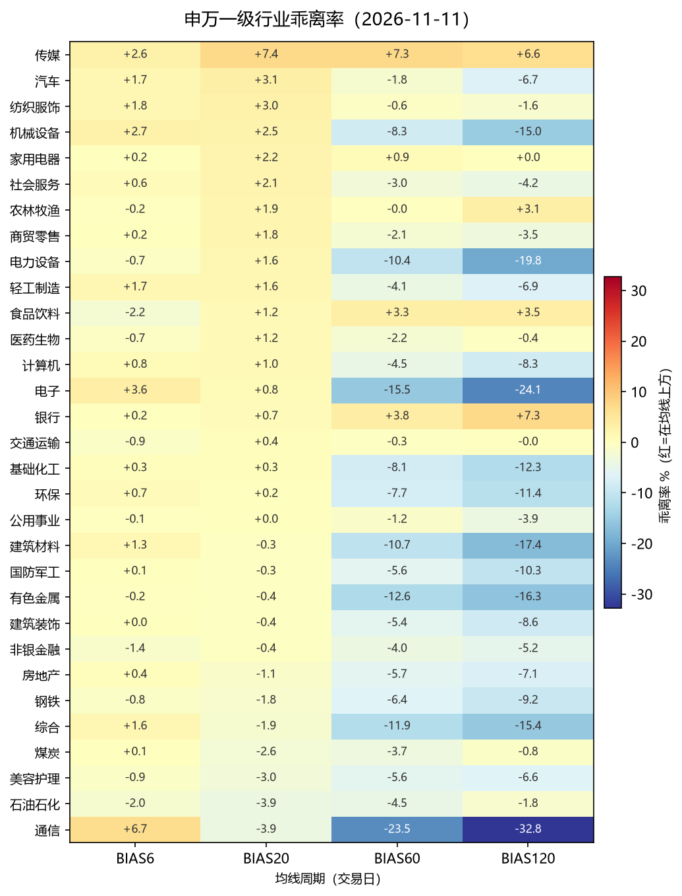
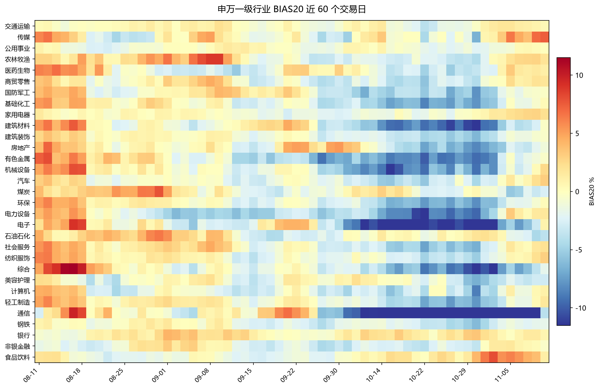
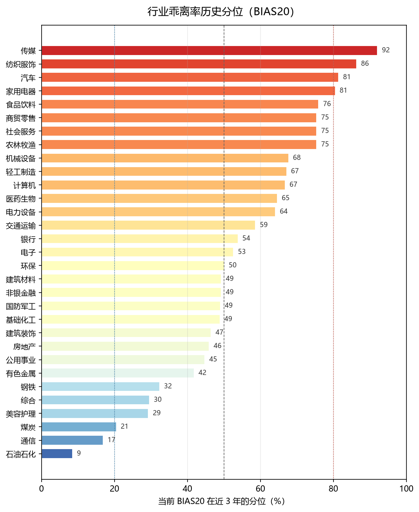

# qlib-cn-research

**A 股量化研究环境：数据管道、指标工具、可复现的策略实验。**

[](LICENSE)
[](requirements.lock.txt)
[](https://github.com/microsoft/qlib)

用 [qlib](https://github.com/microsoft/qlib) 做 A 股研究，真正花时间的从来不是调模型，是数据。
这个仓库把三件事放在一起：数据怎么拿、怎么验、怎么用；几个能一眼看懂的行业指标；
以及若干次**结论算不上好看但足够诚实**的策略实验。

所有数据都来自公开免费接口（腾讯行情、申万指数、巨潮公告、Tushare 的低积分接口），
不需要付费数据源。仓库里只有代码和文档——数据和二进制由脚本重新生成。

---

## 一次真实的输出

31 个申万一级行业、四个周期的乖离率（`BIAS_n = (close − MA_n) / MA_n`），以及当前值在过去
3 年里的历史分位：



横向看截面，纵向看时间轴——同一批数据，两种读法：



2026-11-11 的读数：传媒是唯一四个周期全正的行业（+2.6 / +7.4 / +7.3 / +6.6），BIAS20 分位 92；
通信 BIAS6 已转正 +6.7，但 BIAS120 还在 -32.8，分位 17——超跌修复的早期形态，不是反转确认。
分位图把绝对值翻译成稀有度：同样是 -3.9%，通信排在近三年 17% 的位置，石油石化排在 9%。



生成这三张图的命令是一条：

```cmd
python tools/industry_bias_heatmap.py --refresh
```

---

## 这里有什么

**1. 数据管道（`tools/`）**

腾讯日线抓取（前复权 + 乘权后复权推导，双域名轮换、断点续传、`--resume`）、申万一级行业指数、
巨潮公告、Tushare 交叉校验，以及一套把「我抓的数到底对不对」跑成自动化的问题清单。

```cmd
python tools/selftest_fetch.py          # 37 项自检，0.1s 跑完
python tools/verify_fetched_prices.py   # 复权口径核对：不复权价 MAD 2e-8
```

**2. 行业与个股指标（`tools/industry_bias_heatmap.py`）**

一个脚本出三张图：行业间截面、时间轴演变、自身历史分位。数据每日缓存，重算几秒。

**3. 策略实验（`projects/`）**

每个项目一个目录，含 `PLAN.md`（先写计划）、可复现脚本、原始结果，以及一份写清「哪里失效了」的报告。
包括沪深300 成分股上的 LightGBM 选股、多因子混合、单票择时，两个标的的涨跌新闻归因，
以及一份行业乖离率的对外长文。

---

## 快速开始

需要 Python 3.12。数据不进仓库，第一次要自己拉（约 190 MB，断点续传）。

```cmd
:: 1. 环境
uv venv --python 3.12
uv pip install --python .venv\Scripts\python.exe -r requirements.lock.txt

:: 2. 数据（三选一或全要；qlib bin 数据集见下节）
python tools/fetch_data.py && python tools/unzip_data.py
python tools/fetch_sw_industry.py

:: 3. 自检：这一步全绿，环境就是对的
python tools/selftest_fetch.py
```

qlib 侧需要一份 bin 格式数据集（`qlib_data/cn_data/`），来源见下一节。两个官方示例的本地化改造版
已经指向这个路径，可以直接跑：

```cmd
python examples/01_quickstart.py
qrun examples/workflow_lgb_alpha158.yaml     # 训练 → 预测 → IC → 回测，约 5 分钟 / 16 核
```

示例二在这台 16 核机器上的结果：IC 0.0468 / Rank IC 0.0491 / 组合年化 12.60%（含成本）/
IR 1.4286 / 最大回撤 -7.23%，与 qlib 官方 LightGBM+Alpha158 基准同量级——这说明数据链路是通的。

**环境事实**：pyqlib 0.9.8（`git+https://github.com/microsoft/qlib.git@54355232`），
numpy 2.5.4 / pandas 2.3.3 / lightgbm 4.7.0 / mlflow 3.12.0，194 个依赖全部锁在
`requirements.lock.txt`。

---

## 仓库结构

```
tools/          数据抓取、校验、指标与可视化脚本（先看 tools/README.md）
docs/           qlib 使用手册、数据更新方案、公众号长文与配图
projects/       策略与归因实验，一个目录一个项目
examples/       官方示例的本地化改造版
data/           ← 抓取的数据（不进 git，脚本可重建）
qlib_data/      ← qlib bin 数据集（不进 git）
```

为什么数据一律不进 git：`qlib_data/` 约 1 GB / 9.5 万个文件，`data/` 190 MB，
某个项目的 parquet 就有 1.5 GB。它们全都能由脚本重建，放进来只会让 clone 变成灾难。

---

## 数据从哪来

| 数据 | 来源 | 说明 |
|---|---|---|
| A 股日线 | 腾讯行情（`web.ifzq.gtimg.cn` + `proxy.finance.qq.com` 双域名） | 免费、无限频、支持长历史；前复权与后复权都是**等额**调整，乘权因子要自己推 |
| 行业指数 | 申万官方接口（`index_publish/trend`） | 31 个一级行业，1999-12-30 起 |
| 公告 | 巨潮资讯（cninfo） | 按年拉取，公告 PDF 用 MinerU 解析 |
| qlib bin 数据集 | [SunsetWolf/qlib_dataset](https://github.com/SunsetWolf/qlib_dataset/releases)（首次全量，187 MB）+ [chenditc/investment_data](https://github.com/chenditc/investment_data)（2026 年日更 dump） | 二选一即可；日更那份要自己追加当日 bar |
| 交叉校验 | Tushare `daily` | 只用来核对腾讯价（9 天重叠，最大差 0.000000），不作主数据源 |

---

## 几条值得先知道的坑

都是真踩过的，写在这里省你几个晚上：

1. **腾讯的「复权」是等额调整，不是乘权。** 前复权价 = 原始价 − 累计分红，所以
   `factor = qfq/raw` 是错的；要还原乘权后复权，得从分红阶梯反推
   `F = Π 1/(1 − 分红/前收)`，再 `hfq = raw × F`。
2. **日更脚本默认只补几只标的。** qlib 日历到了 10-30，但 300 只成分股里 298 只的行情只到 10-27，
   直接算会得到「最后三天全 NaN」、特征失效、模型输出看起来像乱码。
3. **申万 2021-12-13 重分类。** 石油石化这类「新」行业历史只到 2021 年底，
   算分位不能跨分类拼接。
4. **成本是结论的一部分，不是脚注。** 一个测试期年化 -2.13% 的策略，零成本是 -0.02%——
   每年 2 个百分点的摩擦把最后一点也抹掉了。
5. **回测里的「等权 20 只」是一行代码，实盘里是 100 股的最小交易单位。** 为了「每只至少 1 手」，
   账户会悄悄超配高价股：20 万预算实际投出 25.6 万，等权假设当场破产。

更多写在 [`docs/QLIB_USAGE.md`](docs/QLIB_USAGE.md)（15 条 qlib 实测坑）和
[`AGENTS.md`](AGENTS.md)（工作手册，含两套数据源的更新流程）。

---

## 实验结果（都不好看，所以值得看）

| 项目 | 做法 | 结果 |
|---|---|---|
| [`projects/jac_600418`](projects/jac_600418) | 单票择时：Ridge 21 因子 → 5 日平滑 → 分数分位 + MA20 双条件 | 验证期 2017-2018 年化 +13.76%（IR +0.571）→ 测试期 2019-2020 **-18.96%**（IR -0.898）。诚实的样本外失败：凶手是择时 + 30 倍年化换手 |
| [`projects/csi300_lgbm`](projects/csi300_lgbm) | 沪深300 时点成分股，30 个价量特征，LightGBM 月度 top10 | 验证期 +20.86%（IR 1.22）→ 测试期 **-2.13%**（IR -0.07）。**排序信号是真的，集中持有不成立** |
| [`projects/trend_combo`](projects/trend_combo) | 价量 0.65 / 基本面 0.30 / 事件 0.05 混合打分，top50、40 日调仓、单行业≤3 | 纯价量 **-0.98%**、纯基本面 **-3.33%**、混合 **+5.84%**；加行业上限 → +7.54% |
| [`projects/jac_600418/news_attribution`](projects/jac_600418/news_attribution) | 772 次明显涨跌 × 4665 条公告的新闻归因 | 只有 **30.1%** 的异动能找到事前公开证据；11 类公告的事件研究单独成表 |
| [`projects/iflytek_002230`](projects/iflytek_002230) | 科大讯飞 574 个事件 + 18 年收益解剖 | AI 标签的边际效应在衰减 |
| [`projects/bias_post`](projects/bias_post) | 31 行业乖离率 + 上述策略的对外长文 | 7 节、4 图，数字自检 46 项 |

一条跨项目反复出现的规律：**验证期挑出来的最优配置，到测试期经常连符号都反**。
所以这里的每个项目都保留「干脆别择时」的基线，并且把失效过程写进报告，而不是只放好的那张图。

---

## 免责声明

所有内容为研究与工程记录，**不构成投资建议**。数据版权归各来源（腾讯、申万、巨潮、Tushare、
chenditc）所有，本仓库不包含任何数据文件，只提供获取与校验的方法。
策略结果均为历史回测或事后归因，不预示未来表现。

## 许可

代码以 **MIT** 许可发布，见 [LICENSE](LICENSE)：可以随意使用、修改、商用，保留版权声明即可。

`docs/` 与 `projects/*/report`、`projects/*/dist` 下的文章正文由本仓库作者撰写，同样按 MIT 授权；
文中引用的公司财报数据、公告与行情数据的版权归各自来源（巨潮、申万、腾讯等），不在本许可范围内。
